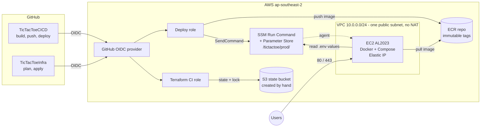
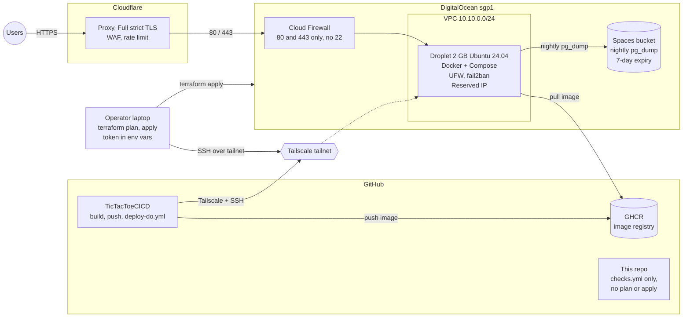
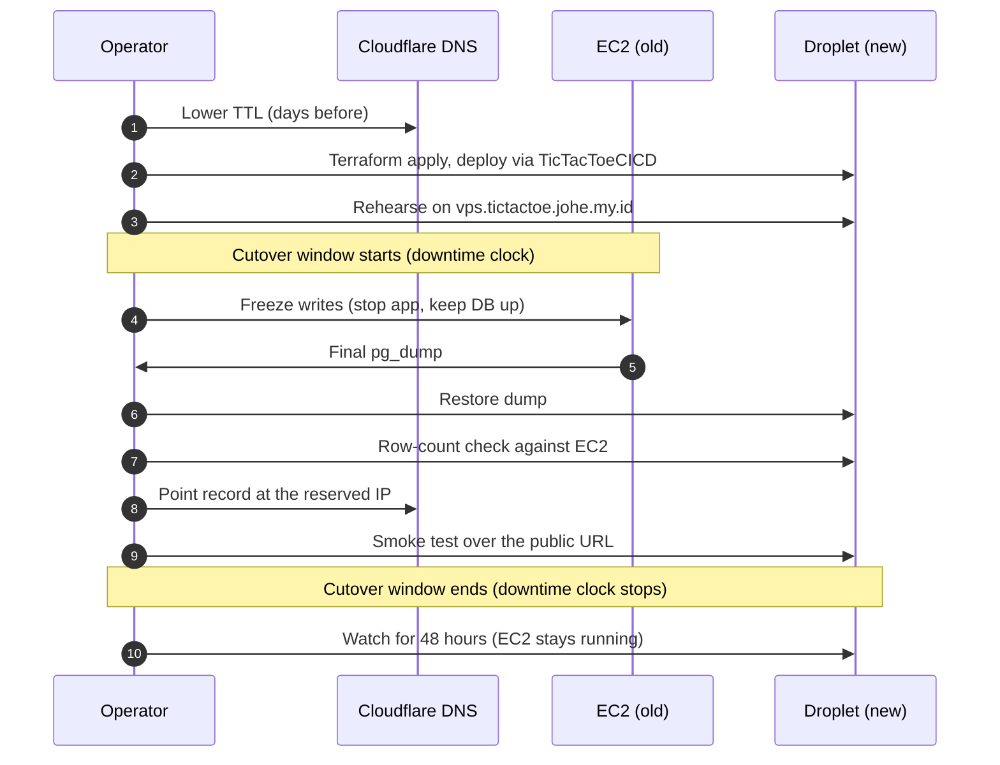

# TicTacToeVpsMigration

Moving a production app off AWS onto a cheap VPS, safely and measurably: a
written cutover plan, a rollback, measured downtime and no lost data.

The workload is the tic-tac-toe app from
[TicTacToeCICD](https://github.com/joheee/TicTacToeCICD) (today on AWS EC2, built
by [TicTacToeInfra](https://github.com/joheee/TicTacToeInfra), about $25 a month)
at `tictactoe.johe.my.id`. This repo moves it, with its PostgreSQL data, to a
**DigitalOcean Droplet** (2 GB, Ubuntu 24.04, `sgp1`) at about **$17 a month**,
then retires the AWS stack.

> **Status:** the Terraform and cloud-init code is written and passes `fmt`,
> `validate`, `tflint` and `shellcheck`. It has **not been applied yet**. Sections
> marked `TODO` are filled in from the rehearsal and the real cutover; nothing in
> them is invented.

## Contents

1. [What this repo contains](#what-this-repo-contains)
2. [Architecture, before and after](#architecture-before-and-after)
3. [Outputs contract](#outputs-contract)
4. [Quick start](#quick-start)
5. [Server hardening](#server-hardening)
6. [Cloudflare settings](#cloudflare-settings)
7. [Cutover runbook](#cutover-runbook)
8. [Rollback runbook](#rollback-runbook)
9. [Downtime log](#downtime-log)
10. [Cost, before and after](#cost-before-and-after)
11. [Remote state](#remote-state)
12. [Checks and CI](#checks-and-ci)
13. [Reusing the kit on Hetzner or another VPS](#reusing-the-kit-on-hetzner-or-another-vps)
14. [Retiring AWS](#retiring-aws)
15. [Progress](#progress)

## What this repo contains

This repo is **Terraform, server setup and the migration runbooks only**. The
app, Compose file, Caddyfile and pipeline live in TicTacToeCICD, which reads
this repo's outputs as GitHub Actions variables.

| Repo | Holds |
|---|---|
| **TicTacToeVpsMigration** (this repo) | Terraform for the Droplet, VPC, Cloud Firewall, reserved IP and backup bucket; cloud-init hardening; checks workflow; cutover and rollback runbooks, diagrams, downtime log, cost table |
| **TicTacToeCICD** | The app, Compose, Caddyfile, and the pipeline: GHCR push, `deploy-do.yml` (Tailscale + SSH deploy, smoke test, rollback), nightly `pg_dump` job. Its AWS `deploy.yml` stays until cutover. |
| **TicTacToeInfra** | The AWS stack being retired. No DigitalOcean resources; destroyed after the cutover. |

```
.
├── terraform/            DigitalOcean provider, root module and four child modules
│   └── modules/
│       ├── network/      VPC, tag, Cloud Firewall (80/443 only)
│       ├── compute/      SSH key, Droplet, reserved IP and its assignment
│       ├── storage/      Spaces backup bucket with a 7-day lifecycle rule
│       └── project/      DigitalOcean project that groups the resources
├── cloud-init/           user-data template that hardens Ubuntu (provider-agnostic)
├── scripts/              extract-bootstrap.sh, used by CI to shellcheck the embedded script
└── .github/workflows/    checks.yml (no plan or apply from CI)
```

Only `terraform/` is DigitalOcean-specific. Everything from `cloud-init/`
upward runs on any Ubuntu VPS.

## Architecture, before and after

### Before: AWS (about $25 a month)



### After: DigitalOcean (about $17 a month)



SSH is not reachable from the internet. The deploy workflow and the admin reach
the Droplet over the tailnet, which only needs outbound traffic.

### What changes

| Concern | Before (AWS) | After (DigitalOcean) |
|---|---|---|
| Compute | EC2 | Droplet, `s-1vcpu-2gb`, `sgp1` |
| Image registry | ECR | GHCR (free, no new secrets, portable) |
| Deploy channel | SSM | Tailscale + SSH, key-only |
| Public ingress | Security group | Cloud Firewall, 80/443 only, plus UFW |
| Backups | n/a in this repo | Spaces bucket, 7-day lifecycle rule |
| Edge | n/a | Cloudflare proxy, Full (strict) TLS, WAF, rate limit |
| Database | PostgreSQL in Compose | PostgreSQL in Compose (unchanged, restored from a dump) |

### Why GHCR and not DigitalOcean Container Registry

DigitalOcean's Container Registry would add up to a few dollars a month on a
paid tier, and its free tier is small for an app image plus rollback history. It
would also put a DigitalOcean credential into GitHub. GHCR costs nothing, uses
the built-in `GITHUB_TOKEN` and keeps the kit portable.

## Outputs contract

TicTacToeCICD copies these outputs into its GitHub Actions variables. **Renaming
or removing one is a breaking change** for the app repo. Adding new ones is fine.

| Terraform output | App repo variable | What it is |
|---|---|---|
| `droplet_ipv4` | `DO_DROPLET_IP` | Reserved IP the DNS record points at |
| `tailscale_hostname` | `DO_TAILSCALE_HOST` | Host the deploy workflow SSHes to over the tailnet |
| `deploy_user` | `DO_DEPLOY_USER` | Non-root user the deploy runs as |
| `app_url` | `DO_APP_URL` | Public URL for the smoke test |
| `backup_bucket` | `DO_BACKUP_BUCKET` | Spaces bucket for nightly `pg_dump` files |
| `spaces_endpoint` | `DO_SPACES_ENDPOINT` | S3-compatible endpoint for that bucket |

Read them with `terraform output -raw <name>`.

## Quick start

### Prerequisites

- A DigitalOcean account with a **billing alert set by hand** in the control
  panel ($5 or $10; Terraform cannot create it).
- A DigitalOcean API token (read and write) and a Spaces key pair.
- A [Tailscale](https://tailscale.com) account and a **one-time, short-expiry,
  non-reusable** auth key. It ends up in `user_data` and in Terraform state, so
  treat the state file as a secret.
- Terraform >= 1.10, `tflint` and `shellcheck` for the local checks.

### Credentials: environment variables only

```bash
export DIGITALOCEAN_TOKEN="..."
export SPACES_ACCESS_KEY_ID="..."
export SPACES_SECRET_ACCESS_KEY="..."
```

Never commit a token, a Spaces key, a Tailscale auth key, `*.tfstate`,
`.terraform/`, a `.env` file or a real `.tfvars` file. The `.gitignore` covers
them; only `*.example` files are committed.

### Plan, apply, destroy

```bash
cd terraform
cp terraform.tfvars.example terraform.tfvars   # git-ignored; fill in the placeholders
terraform init
terraform plan                                  # read it before applying
terraform apply
terraform output
```

Test runs end with `terraform destroy`, **never a shutdown**: Droplets bill by
the hour even when powered off, and a reserved IP costs money when it is not
attached to a Droplet. For cheap test runs set `create_backup_bucket = false`
(Spaces is $5 a month).

### Input variables

| Variable | Default | Notes |
|---|---|---|
| `project` | `tictactoe` | Name prefix |
| `environment` | `prod` | `prod` or `dev` |
| `region` | `sgp1` | Closest region to Indonesia |
| `vpc_cidr` | `10.10.0.0/24` | |
| `droplet_size` | `s-1vcpu-2gb` | About $12 a month |
| `droplet_image` | `ubuntu-24-04-x64` | |
| `admin_ssh_public_key` | required | Registered with DigitalOcean; root login is disabled by cloud-init |
| `deploy_ssh_public_keys` | required | Your key and the CI key for the `deploy` user |
| `tailscale_hostname` | `tictactoe-do` | Name on the tailnet |
| `tailnet_domain` | `""` | For example `tailnet-name.ts.net`; empty makes the output the short name |
| `tailscale_auth_key` | required, sensitive | One-time key |
| `app_hostname` | `vps.tictactoe.johe.my.id` | Rehearsal host first, the real host at cutover |
| `create_backup_bucket` | `true` | |
| `backup_bucket_name` | `tictactoe-prod-backups` | |
| `backup_retention_days` | `7` | Lifecycle rule expiry |
| `backup_bucket_force_destroy` | `false` | Leave false once real backups exist |

### Things to know before the first apply

- **`user_data` and `image` changes are ignored** (`ignore_changes`). Changing
  them would replace the Droplet and wipe the database on its disk. An edit to
  the cloud-init template therefore applies only to a **new** Droplet.
- **The firewall attaches by tag**, so it exists before the Droplet does.
- **Outbound traffic is open** because GHCR, Let's Encrypt, Spaces, apt and
  Tailscale need it.
- **Budget:** about $17 a month (Droplet about $12, Spaces $5). Skip DigitalOcean
  backups, snapshots, volumes, load balancers and managed databases; they add
  cost the plan does not need.

## Server hardening

`cloud-init/cloud-config.yaml.tftpl` configures a fresh Ubuntu LTS server. It
sets up:

- a non-root `deploy` user (key-only, passwordless sudo, member of `docker`)
- SSH: no passwords, no root login, `AllowUsers deploy`, `MaxAuthTries 3`
- UFW: deny incoming; allow 80 and 443; allow SSH only on the `tailscale0`
  interface
- fail2ban for `sshd`, and unattended-upgrades
- Docker and the Compose plugin from Docker's official apt repository, with
  log rotation (`10m` x 3 files)
- Tailscale from its official apt repository, joined with a one-time auth key
  that is deleted right after `tailscale up`
- a 2 GB swap file, and `/opt/app` owned by `deploy`

Order matters: **Tailscale joins before UFW is enabled**, so the server never
ends up with no way in.

Anything beyond this (app files, `.env`, containers) belongs to the app
pipeline in TicTacToeCICD.

> **Risk to know about:** because `AllowUsers deploy` is set and port 22 is not
> open to the internet, a failed `tailscale up` leaves the Droplet with no SSH
> access at all. The recovery path is `terraform destroy` and a new apply. This
> is why the first test run must confirm Tailscale access before anything else
> is relied on. Docker publishes container ports around UFW, so the Cloud
> Firewall is the real guard for 80 and 443.

## Cloudflare settings

Set by hand in the Cloudflare dashboard (the Cloudflare provider is a stretch
goal). `TODO`: record the exact values here once applied.

| Setting | Value |
|---|---|
| DNS | `johe.my.id` on Cloudflare |
| Record | `A` record for `tictactoe` (and `vps.tictactoe` for the rehearsal) pointing at the reserved IP, **proxied** |
| SSL/TLS mode | **Full (strict)** |
| WAF | Managed rules on |
| Rate limiting | Rule on the login and register endpoints (`TODO`: paths and thresholds) |
| TTL before cutover | Lowered ahead of the flip (see the runbook) |

TicTacToeCICD's Caddy must trust Cloudflare's IP ranges (`trusted_proxies`) so
its per-IP rate limit sees the real client address, not Cloudflare's.

## Cutover runbook

Goal: move the app and its data from EC2 to the Droplet with a few minutes of
**planned** downtime and a write freeze. Zero-downtime and high availability are
out of scope.

> The exact database service name, user and database name come from
> TicTacToeCICD's Compose file. The commands below use placeholders; confirm
> them against that repo before the rehearsal.



### Before the day

1. Droplet is applied, Tailscale access is confirmed, and the deploy workflow
   has deployed the app to it successfully at least once.
2. The nightly `pg_dump` has run to the Spaces bucket and one restore has been
   tested (tracked in TicTacToeCICD).
3. **Lower the DNS TTL** on the record (for example to 60 seconds) at least one
   old-TTL period before the cutover, so the flip propagates quickly.
4. Cloudflare is set up as in [Cloudflare settings](#cloudflare-settings).
5. EC2 Elastic IP is written down: it is the rollback target.
6. Pick a quiet window and tell anyone who needs to know.

### Rehearsal on `vps.tictactoe.johe.my.id`

Run the full procedure below against the `vps.` hostname, with the real dump,
and **time every step**. Record the result in the [downtime log](#downtime-log).
Fix whatever is slow or confusing, then rehearse again if needed.

### The cutover

Start a stopwatch at step 2 and stop it at step 7.

1. **Announce** the window and confirm EC2 is healthy.
2. **Freeze writes** on EC2: stop the app container so nothing writes, but keep
   the database container running.

   ```bash
   # on EC2, in the app directory (service names: confirm in the Compose file)
   docker compose stop app
   ```

3. **Final dump** from EC2:

   ```bash
   docker compose exec -T db pg_dump -U "$POSTGRES_USER" -Fc "$POSTGRES_DB" > final.dump
   ```

4. **Copy and restore** on the Droplet (over Tailscale):

   ```bash
   scp final.dump deploy@tictactoe-do:/opt/app/
   # on the Droplet:
   docker compose exec -T db pg_restore -U "$POSTGRES_USER" -d "$POSTGRES_DB" --clean --if-exists < final.dump
   ```

5. **Row-count check.** Compare counts for every table on both sides. They must
   match before DNS moves.

   ```bash
   docker compose exec -T db psql -U "$POSTGRES_USER" -d "$POSTGRES_DB" -c \
     "SELECT relname, n_live_tup FROM pg_stat_user_tables ORDER BY relname;"
   ```

   Use exact `SELECT count(*)` per table for the final comparison, because
   `n_live_tup` is only an estimate.
6. **Flip DNS:** point the `tictactoe` record at the reserved IP
   (`terraform output -raw droplet_ipv4`), proxied.
7. **Smoke test** the public URL (`terraform output -raw app_url`): load the
   page, register or log in, play a game, check the response over HTTPS. Stop the
   stopwatch when it passes.
8. **Watch** for 48 hours: Caddy and app logs, uptime check, the nightly backup
   landing in the bucket. **EC2 keeps running** the whole time.

### When to abort

Abort and roll back if the row counts differ, the restore errors, the smoke
test fails and is not fixed within the agreed time, or the site shows
certificate or redirect loops after the flip.

## Rollback runbook

Rollback is a DNS flip back to the EC2 Elastic IP. It works because EC2 is kept
running, untouched, for 48 hours after the cutover.

1. Decide to roll back (see [When to abort](#when-to-abort)) and note the time.
2. In Cloudflare, point the `tictactoe` record back at the **EC2 Elastic IP**.
3. Wait for the (lowered) TTL, then smoke test the public URL.
4. **Writes made on the Droplet after the cutover are not on EC2.** If the app
   took writes during that period, dump them from the Droplet and decide
   whether to replay them onto EC2 before resuming. With a short window and a
   freeze this is usually a handful of rows or none.
5. Record what failed in the [downtime log](#downtime-log), fix it, and
   reschedule.

The rollback is **tested** during the rehearsal, not just written down: flip DNS
to EC2 and back on the `vps.` hostname and time it. `TODO`: record the result.

## Downtime log

Measured, not estimated. `TODO`: fill in during the rehearsal and the real
cutover.

| Run | Date | Window start | Window end | Measured downtime | Rollback tested | Notes |
|---|---|---|---|---|---|---|
| Rehearsal 1 | `TODO` | `TODO` | `TODO` | `TODO` | `TODO` | |
| Real cutover | `TODO` | `TODO` | `TODO` | `TODO` | `TODO` | |
| Rollback test | `TODO` | `TODO` | `TODO` | `TODO` | n/a | |

## Cost, before and after

| Line item | Before (AWS) | After (DigitalOcean) |
|---|---|---|
| Compute | `TODO` (EC2 and related) | Droplet `s-1vcpu-2gb`: about $12 |
| Image registry | `TODO` (ECR) | $0 (GHCR) |
| Backups | n/a | Spaces: $5 |
| Other | `TODO` (EBS, data transfer, SSM) | $0 |
| **Monthly total** | **about $25** | **about $17** |

The sign-up credit on a new DigitalOcean account is **not** counted here, since
the amount changes. The cutover needs the Droplet for about five days
(rehearsal, cutover, 48-hour watch), roughly $2.

Cost guards: a billing alert set by hand, no DigitalOcean backups, snapshots,
volumes or load balancers, and every test run ends in `terraform destroy`.

## Remote state

State is **local while testing**. After that it moves to a hand-made Space
through the S3 backend:

- `endpoints.s3` pointing at the Space's regional endpoint
- `use_path_style`
- the `skip_*` validation flags (DigitalOcean is not AWS)

The switch is `terraform init -migrate-state`. Credentials stay in
`SPACES_ACCESS_KEY_ID` and `SPACES_SECRET_ACCESS_KEY`, and the Space is created
by hand so Terraform does not depend on its own state bucket.

`TODO`: test whether `use_lockfile = true` works on Spaces with two concurrent
`plan` runs. If it does not, state here is **single-writer**, and this section
will say so.

## Checks and CI

`.github/workflows/checks.yml` runs on every pull request and every push to
`main`:

| Job | What it runs |
|---|---|
| `terraform` | `terraform fmt -check -recursive`, `terraform init -backend=false` + `validate`, `tflint --recursive` |
| `shellcheck` | `scripts/extract-bootstrap.sh` pulls the bootstrap script out of the cloud-init template, then `shellcheck` runs on it and on `scripts/*.sh` |

**There is no `plan` or `apply` in CI.** DigitalOcean has no OIDC federation, so
the API token stays off GitHub and Terraform runs locally.

Run the same checks before every commit:

```bash
terraform fmt -recursive
(cd terraform && terraform init -backend=false && terraform validate && tflint --init && tflint --recursive)
scripts/extract-bootstrap.sh > /tmp/bootstrap-vps.sh && shellcheck -s bash /tmp/bootstrap-vps.sh scripts/*.sh
```

## Reusing the kit on Hetzner or another VPS

The kit is provider-agnostic except for `terraform/`.

1. **Replace `terraform/`** with that provider's equivalent: a server, a
   provider firewall that opens only 80 and 443, a stable IP, and a backup
   bucket (Hetzner has Object Storage; any S3-compatible store works).
2. **Pass `cloud-init/cloud-config.yaml.tftpl` as user data** unchanged. It uses
   only Ubuntu packages, Docker's and Tailscale's apt repositories, and standard
   tools. Keep the template variables (`deploy_user`, `deploy_ssh_public_keys`,
   `tailscale_hostname`, `tailscale_auth_key`).
3. **Keep the outputs contract** (the six names in the table above), so
   TicTacToeCICD works without changes.
4. Everything else, including the runbooks, Cloudflare settings and CI checks,
   applies as written.

Hetzner Cloud is the cheapest "real client" alternative: about 6 EUR a month in
the EU, with Singapore starting at about 15.49 EUR. Oracle Cloud Always Free was
dropped because its sign-up needs a credit card.

## Retiring AWS

Only after the cutover is proven and 48 quiet hours have passed:

1. Confirm the Droplet is healthy, the nightly backup landed in the bucket and
   the uptime check is green.
2. Take a last `pg_dump` from EC2 and keep it somewhere safe.
3. Run `terraform destroy` in TicTacToeInfra.
4. Remove the AWS `deploy.yml` from TicTacToeCICD.

Destroying the AWS stack is the last step and is done only when asked.

## Progress

- [ ] `terraform apply` creates the VPC, Cloud Firewall, Droplet, reserved IP and Spaces bucket within the budget, with all six contract outputs.
- [ ] State lives in a Space; locking is either proven or documented as single-writer.
- [ ] The VM is hardened by cloud-init: key-only SSH reachable only over Tailscale, UFW, fail2ban, unattended-upgrades, Docker.
- [ ] `checks.yml` runs fmt, validate, tflint and shellcheck on every PR.
- [ ] Cloudflare proxies the domain with Full (strict) TLS, WAF and a login rate limit.
- [ ] TicTacToeCICD deploys to the Droplet with smoke test and rollback, and backs up nightly to the bucket (tracked there).
- [ ] Rehearsal and real cutover done with downtime measured; DNS rollback tested.
- [ ] AWS stack destroyed after 48 quiet hours.
- [ ] README has before/after diagrams, the runbook, downtime numbers, outputs table, cost before and after, and how to reuse the kit on Hetzner or another VPS.
